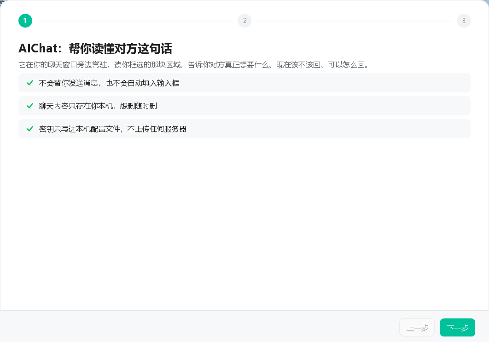
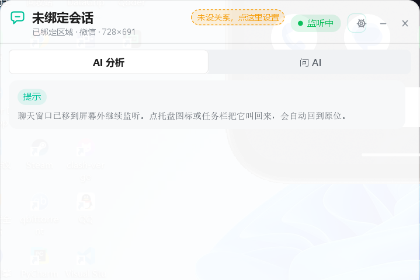
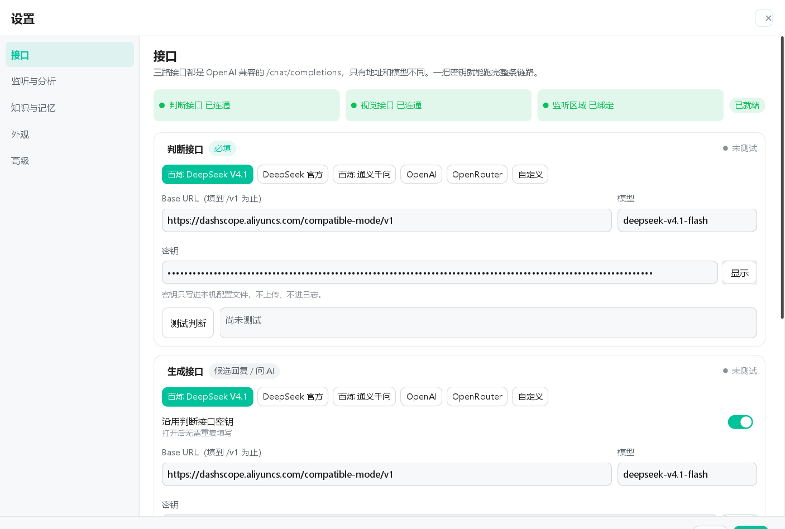
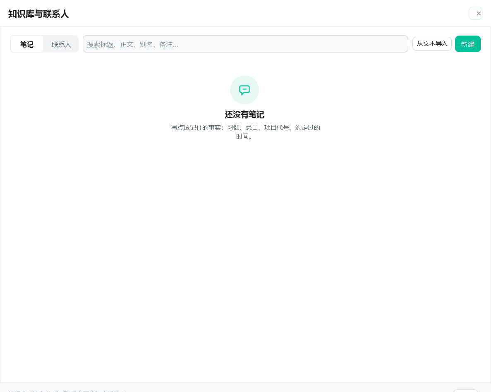
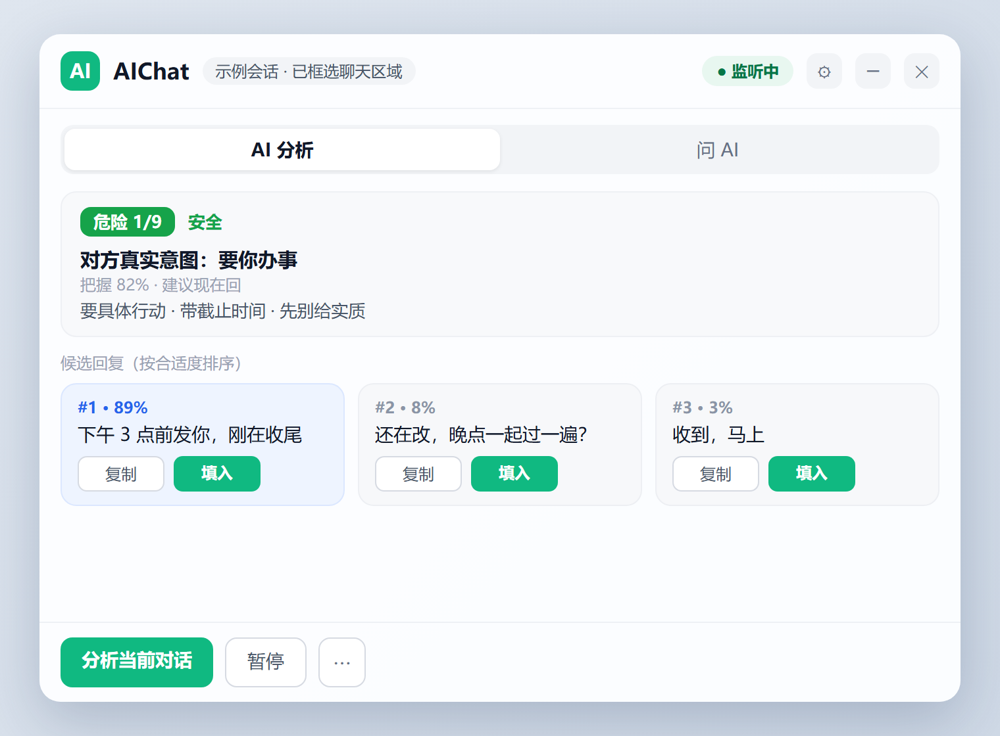
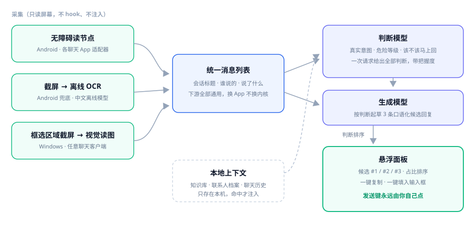

<div align="center">

# AIChat · AI 聊天助手（Windows）

**挂在聊天窗口旁的「对话副驾」：看屏读取正在聊的对话，判断对方意图与风险，起草 3 条候选回复，一键填进输入框——发不发，永远由你。**

[](#下载)
[](#构建与运行)
[](#构建与运行)
[](LICENSE)

姊妹仓库：`aichat-android`（Android 版）

</div>

## 页面展示

| 首次引导 · 三步向导 | 悬浮面板 · 监听中（真实运行截图） |
|---|---|
|  |  |

| 设置 · 三路接口 | 知识库与联系人 |
|---|---|
|  |  |

**悬浮面板 · 分析结果视图**（页面原型示意）：



## 工作链路（概念图）



## 下载

- [Releases](https://github.com/ChencLi819/aichat-windows/releases)：
  - [AIChatAssistant-0.2.1.msi](https://github.com/ChencLi819/aichat-windows/releases/download/v0.2.1/AIChatAssistant-0.2.1.msi) — 安装包，安装到本机并创建开始菜单快捷方式
  - [AIChatAssistant-0.2.1-portable.zip](https://github.com/ChencLi819/aichat-windows/releases/download/v0.2.1/AIChatAssistant-0.2.1-portable.zip) — 便携版 zip，解压后运行文件夹里的 `AIChatAssistant.exe`
- 两者都自带 JRE，**无需安装 Java**。
- 需要 Windows 10 及以上，以及一把你自己申请的模型接口密钥（OpenAI 兼容，判断 / 生成 / 视觉三路可分别配置）。

## 它做什么

- **看屏，不侵入。** 聊天软件对 UI Automation 不暴露控件树（`tools/uia-probe.ps1` 是当时的实测脚本），所以采集走「框选区域 → 定时截屏 → 视觉模型读取」，不 hook、不注入、不读写聊天软件的任何文件与进程内存。
- **它先判断，再写字。** 判断模型先给出对方真实意图、危险等级、该不该马上回，再据此起草 3 条口语化候选并按合适度排序。
- **发送权永远在你手里。** 程序只把候选回复放进面板供复制 / 填入，任何情况下都不替你点发送。
- **它认识你的人和事。** 本地知识库与联系人档案（笔记 / 联系人 / 关系），判断时自动带上命中内容，回复不和你的设定打架。
- **接口自己配。** 判断 / 生成 / 视觉三路都是普通 OpenAI 兼容的 `/chat/completions` 接口，用你自己的密钥和额度，不经过任何中间服务器。

## 环境要求

- Windows 10 及以上
- JDK 17（仅构建需要；打包产物自带 JRE，用户机器无需装 Java）
- 一把你自己申请的模型接口密钥（判断 / 生成 / 视觉三路均可自定义）

## 构建与运行

```bash
./gradlew run          # 开发运行
./gradlew fatJar       # 单个可执行 fat jar（build/libs/aichat-desktop-0.2.1-all.jar）
./gradlew genIcon      # 重新生成 assets/ 下的应用图标（Java2D 绘制，无需图像工具链）
./gradlew packageExe   # jpackage 打包：AIChatAssistant.exe + 自带 JRE 的绿色目录（build/jpackage/）
```

打包出的 `app-image` 目录可直接拷贝到任何 Windows 机器运行，无需安装。首次启动进入三步引导：了解原则 → 配置判断接口并连通测试 → 框选聊天区域。

## 目录结构

```
├── src/main/java/…/
│   ├── capture/     截屏与视觉读取（ScreenGrabber / RegionWatcher / VisionReader）
│   ├── config/      配置存储与采集目标（Config / CaptureTarget）
│   ├── kb/          知识库与联系人、上下文构建（KbStore / ContextBuilder）
│   ├── llm/         判断与生成客户端（LlmJudgeClient / ChatAiClient / ReplyClient）
│   ├── model/       数据模型（Analysis / ChatSnapshot / Msg …）
│   ├── net/         HTTP 与路由（HttpJson / Route）
│   ├── prompt/      判断提示词
│   ├── ui/          Swing 悬浮面板、设置、知识库、引导、主题（含 ui/kit 组件库）
│   └── tools/       图标生成器（IconGenerator）
├── src/test/        冒烟测试
├── assets/          应用图标（由 genIcon 生成，jpackage 取用）
└── tools/           uia-probe.ps1：UIA 可行性探测脚本（采集架构决策依据）
```

## 隐私与安全

- 只处理你自己设备上、你自己有权查看的聊天。
- 密钥与配置存在 `<用户目录>/.aichat-desktop/config.json`，不入代码、不进 git、不写日志（日志只打密钥长度）；判断密钥也可以只通过 `AICHAT_JUDGE_KEY` 环境变量提供，完全不落盘。
- 聊天截图只在你触发分析的那一刻，发给你自己在设置里配置的视觉接口，不落盘、不进日志。
- 项目没有任何自建服务器，不经手任何费用，模型调用按用量在对应服务商结算。

## 许可证

以 [MIT](LICENSE) 协议开源。

**免责声明**：本项目只处理你自己设备上、你自己有权查看的聊天。请遵守聊天软件的许可协议与当地法律法规，作者不对使用后果负责。
